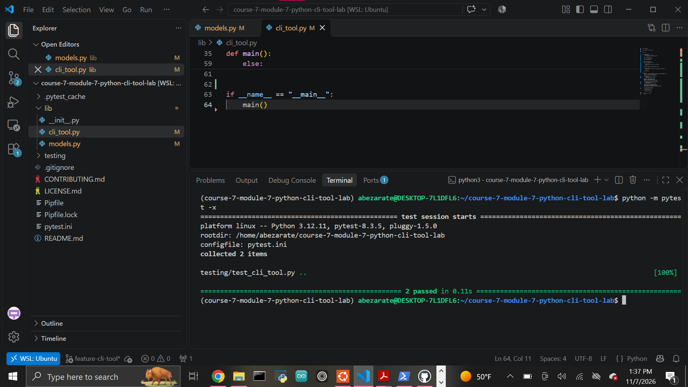

# Python Task Manager CLI

A Python command-line task manager built with object-oriented programming and the standard-library `argparse` module.

The project demonstrates how CLI commands can interact with Python classes to create users, add tasks, find tasks, and mark tasks as completed.

## Features

The application supports:

- Creating users as needed
- Adding tasks to users
- Searching for tasks by title
- Marking tasks as completed
- Displaying confirmation messages
- Displaying helpful messages when users or tasks cannot be found
- Routing CLI commands with `argparse`
- Separating CLI logic from object-oriented models

## Project Design

The application uses two model classes and one CLI controller.

### `Task`

Represents one task.

Each task contains:

- `title`
- `completed`

New tasks begin with:

```python
completed = False
```

Calling:

```python
task.complete()
```

changes the task to:

```python
completed = True
```

and prints a confirmation message.

Example:

```text
✅ Task 'Finish lab' completed.
```

### `User`

Represents a user and their tasks.

Each user contains:

- `name`
- `tasks`

The `tasks` attribute begins as an empty list.

### `add_task()`

Adds a `Task` object to the user's task list.

Example output:

```text
📌 Task 'Submit report' added to Alice.
```

### `get_task_by_title()`

Searches the user's tasks for a matching title.

If the task exists, the method returns the matching `Task` object.

If no matching task exists, it returns `None`.

## CLI Commands

The CLI uses Python's built-in `argparse` module and subcommands.

### Add a Task

Run:

```bash
python -m lib.cli_tool add-task Alice "Submit report"
```

Example output:

```text
📌 Task 'Submit report' added to Alice.
```

The command provides:

```text
add-task
   │
   ├── Alice          → user
   └── Submit report  → task title
```

### Complete a Task

The CLI also supports:

```bash
python -m lib.cli_tool complete-task Alice "Submit report"
```

The completion command searches the in-memory user data for the requested user and task before calling the task's `complete()` method.

## In-Memory State

This project intentionally stores users and tasks in memory using:

```python
users = {}
```

The data exists only while that Python process is running.

Because there is no database or file persistence, running `add-task` and `complete-task` as two completely separate processes does not preserve the task between commands.

The project tests completion behavior within a shared Python process.

Persistent storage could be added later using JSON, SQLite, or another database.

## Argparse

The CLI uses subparsers to route commands.

Supported commands include:

```text
add-task
complete-task
```

Arguments are converted into values such as:

```python
args.user
args.title
```

The appropriate function is then called based on the selected command.

## Package Structure

The CLI is run as a Python module:

```bash
python -m lib.cli_tool
```

The CLI imports its models using a package-relative import:

```python
from .models import Task, User
```

This allows Python to correctly locate `models.py` inside the `lib` package.

## Technologies

- Python 3.12.11
- Argparse
- Object-Oriented Programming
- Pytest
- Pipenv
- Git
- GitHub

## Setup

Clone the repository:

```bash
git clone git@github.com:Abraham-z14/course-7-module-7-python-cli-tool-lab.git
cd course-7-module-7-python-cli-tool-lab
```

Create/install the project environment:

```bash
pipenv --python ~/.pyenv/versions/3.12.11/bin/python install
```

Enter the environment:

```bash
pipenv shell
```

Verify Python:

```bash
python --version
```

Expected version:

```text
Python 3.12.11
```

## Testing

Run the automated tests with:

```bash
python -m pytest
```

Current result:

```text
2 passed
```

The tests verify:

- Adding a task through the CLI
- Using the `User` and `Task` models
- Marking a task as completed
- Correct terminal confirmation messages

## Completed Test Suite



## Project Structure

```text
course-7-module-7-python-cli-tool-lab/
├── images/
│   └── tests-passing.png
├── lib/
│   ├── __init__.py
│   ├── cli_tool.py
│   └── models.py
├── testing/
│   ├── __init__.py
│   └── test_cli_tool.py
├── Pipfile
├── Pipfile.lock
├── pytest.ini
└── README.md
```

## Author

Abraham Zarate